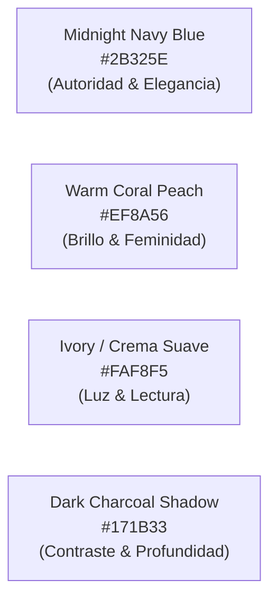

# 🎨 MANUAL DE IDENTIDAD VISUAL Y GUÍA DE ESTILO
**Marca:** BLUE SHINESHOP  
**Archivo Fuente:** `LOGO.jpg` (1080 x 1080 px)  
**Versión:** 1.0 Oficial  

---

## 1. 🌈 Paleta Cromática Extraída y Homologada

La combinación de colores del logotipo logra el balance perfecto entre **autoridad ejecutiva** y **calidez femenina/estilo de vida**:



| Muestra | Nombre | Código HEX | RGB | Rol en el Landing Page & UI |
| :--- | :--- | :--- | :--- | :--- |
| 🔵 | **Midnight Navy Blue** | `#2B325E` | `rgb(43, 50, 94)` | Color primario de marca. Fondo de la cabecera (Hero), pie de página, navbar y títulos principales. |
| 🌌 | **Deep Navy Dark** | `#1C2242` | `rgb(28, 34, 66)` | Variante oscura para sombras profundas, tarjetas destacadas y fondos nocturnos. |
| 🍑 | **Warm Coral Glow** | `#EF8A56` | `rgb(239, 138, 86)` | **Color de Acento & Conversión.** Botones principales de llamado a la acción (CTA), badges de descuento, estrellas de calificación y el brillo "Shine". |
| 🌸 | **Coral Soft Hover** | `#F7A174` | `rgb(247, 161, 116)` | Estado interactivo (Hover/Focus) para botones y enlaces. |
| 🍦 | **Ivory Cream** | `#FAF8F5` | `rgb(250, 248, 245)` | Fondo para secciones claras de catálogo, testimonios y preguntas frecuentes. |
| ⚪ | **Pure White** | `#FFFFFF` | `rgb(255, 255, 255)` | Tarjetas de producto, contenedores y textos sobre fondos oscuros. |
| 🔘 | **Muted Slate** | `#64748B` | `rgb(100, 116, 139)` | Textos secundarios, descripciones técnicas y bordes sutiles. |

---

## 2. 🌿 Narrativa Visual y Significado de los Elementos

1. **La Rama Botánica Lineal (Ícono Central):**  
   Representa **crecimiento personal, frescura orgánica y ligereza**. El trazo doble (línea coral con sombra marina) simboliza la versatilidad de la mujer actual: delicada pero con carácter y estructura.
2. **Tipografía Caligráfica "Blue.Shine":**  
   Transmite cercanía, exclusividad de boutique, calidez y estilo personal (no masivo ni industrial).
3. **El Subtítulo "S H O P" Espaciado:**  
   Tipografía sans-serif con amplio interletreado (*tracking*), que aporta modernidad, orden y balance arquitectónico a la composición.

---

## 3. 📂 Suite de Favicons y Recursos Web Generados

Todos los archivos han sido procesados, optimizados y guardados en la carpeta `public/` y `public/assets/`:

| Archivo | Ruta | Dimensiones | Uso / Compatibilidad |
| :--- | :--- | :--- | :--- |
| `favicon.svg` | `public/favicon.svg` | Vectorial Escalonable | Navegadores modernos (Chrome, Safari, Firefox, Edge) con nitidez infinita en pantallas Retina/4K. |
| `favicon.ico` | `public/favicon.ico` | 32 x 32 px | Compatibilidad universal estándar con pestañas de navegador. |
| `favicon-32x32.png` | `public/assets/favicon-32x32.png` | 32 x 32 px | Pestañas de escritorio estándar. |
| `favicon-16x16.png` | `public/assets/favicon-16x16.png` | 16 x 16 px | Pestañas de baja resolución o marcadores. |
| `apple-touch-icon.png` | `public/apple-touch-icon.png` | 180 x 180 px | Marcador de pantalla de inicio en iPhones y iPads (iOS). |
| `logo-icon-512.png` | `public/assets/logo-icon-512.png` | 512 x 512 px | Splash screen, Progressive Web App (PWA) y avatares de redes. |
| `logo-full.jpg` | `public/assets/logo-full.jpg` | 1080 x 1080 px | Logotipo oficial completo de alta resolución. |

---

## 4. 💻 Código HTML para Implementar el Favicon en la Landing Page

Cuando construyamos el `index.html` de la Landing Page, incluiremos estas etiquetas en el `<head>`:

```html
<!-- Favicons Oficiales BLUE SHINESHOP -->
<link rel="icon" type="image/svg+xml" href="/favicon.svg" />
<link rel="icon" type="image/png" sizes="32x32" href="/assets/favicon-32x32.png" />
<link rel="icon" type="image/png" sizes="16x16" href="/assets/favicon-16x16.png" />
<link rel="apple-touch-icon" sizes="180x180" href="/apple-touch-icon.png" />
<meta name="theme-color" content="#2B325E" />
```

---

## 5. 🏷️ Tokens CSS para la Web

Variables listas para TailwindCSS o CSS Vanilla:

```css
:root {
  --color-primary-navy: #2B325E;
  --color-primary-dark: #1C2242;
  --color-accent-coral: #EF8A56;
  --color-accent-hover: #F7A174;
  --color-bg-cream: #FAF8F5;
  --color-text-main: #1E293B;
  --color-text-muted: #64748B;
  --color-white: #FFFFFF;
}
```
